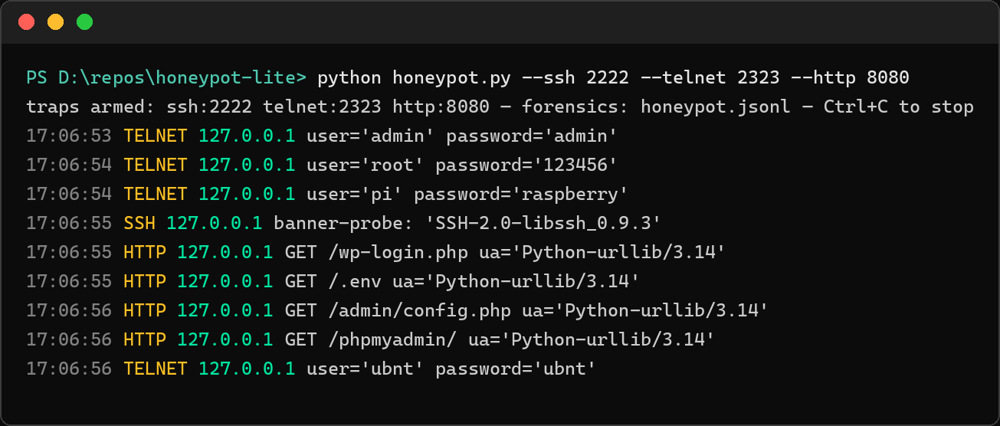

# honeypot-lite

[](https://github.com/amanvicky/honeypot-lite/actions/workflows/ci.yml)

A **real-time trap** for scanners and brute-forcers: three fake services, one live feed, every probe recorded. Zero dependencies — stdlib sockets and `http.server` only. Built by a cybersecurity trainer for students who want to *watch* attack traffic instead of reading about it.



Every line above is a real event from a real run: the telnet trap caught `admin/admin`, `root/123456`, `pi/raspberry` and `ubnt/ubnt`; the SSH banner probe got answered by `libssh_0.9.3`; the HTTP trap logged a scanner walking `/wp-login.php`, `/.env`, `/admin/config.php` and `/phpmyadmin/`.

## ⚠️ Run at your own responsibility

This is a **defensive, educational tool**. Deploying it exposes listening services — that's the point — and with that exposure comes responsibility, all of it yours:

- **Only run it on machines and networks you own**, or with written authorization from whoever does.
- **Know the law where you and your server live.** Monitoring and logging rules differ by country and state.
- **Don't attach it to networks that hold real user data.** A lab VM, a Raspberry Pi, or a cheap VPS with nothing else on it is the right home.
- **Everything that happens after you start it is your call** — exposure, log retention, what you do with the intel. The author is not responsible for your deployment.

If any of that is unclear, don't run it yet.

## The three traps

| Trap | Default port | What it catches |
|---|---|---|
| `ssh-banner` | 2222 | Greets scanners with an OpenSSH banner and records whatever they send next — client strings, key-exchange probes |
| `telnet-auth` | 2323 | A convincing `login:` / `Password:` prompt; records **every credential** scripts type into it — the juiciest feed |
| `http` | 8080 | Serves an empty site and logs every method, path and user-agent — scanner fingerprints land straight in the feed |

## Forensics, not just a pretty feed

Every event is appended to `honeypot.jsonl` the moment it lands — one JSON object per line, UTC timestamp, kind, source IP, and the details:

```json
{"ts": "2026-11-12T17:06:54+00:00", "kind": "telnet", "ip": "192.0.2.7", "user": "root", "password": "123456"}
```

Ctrl+C prints a session summary with counts and the top talkers.

## Run

```bash
python honeypot.py                       # defaults: 2222 / 2323 / 8080, feed on
python honeypot.py --http 80 --ssh 22    # well-known ports want admin/root
python honeypot.py --quiet               # forensics only, no live feed
```

## Tests

```bash
pytest tests/ -q      # 7 tests, ~1 s
```

The suite spins the **real traps** on ephemeral ports and hits them with **real sockets** — the telnet capture, the SSH probe, HTTP paths — then asserts exactly what the forensics recorded. Same code path as production, no mocks.

## Honest scope

This is **low-interaction**: it captures probes and credentials, not full sessions (that's [cowrie](https://github.com/cowrie/cowrie)'s job, and you should run cowrie too if you're serious). No geolocation, no alerting integrations, no internet-facing hardening — it's a teaching instrument that also happens to be useful, not a production SOC.
